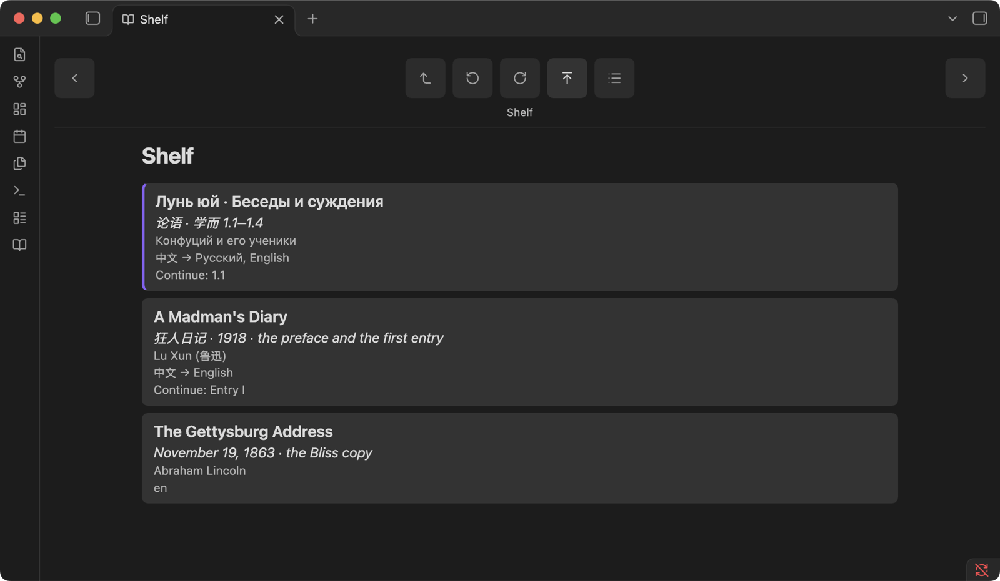
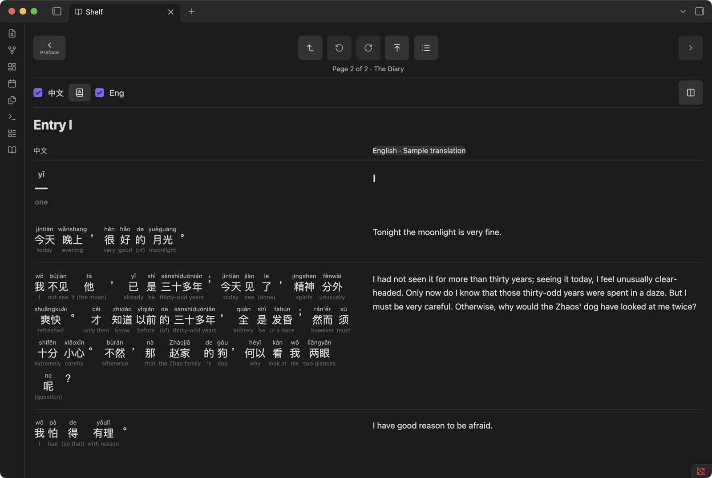
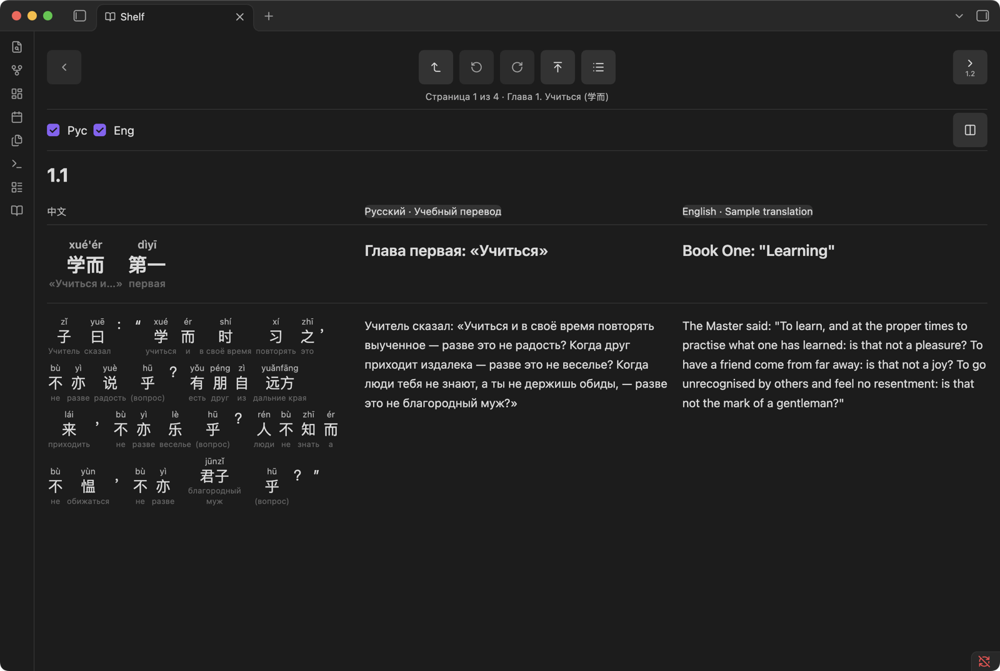
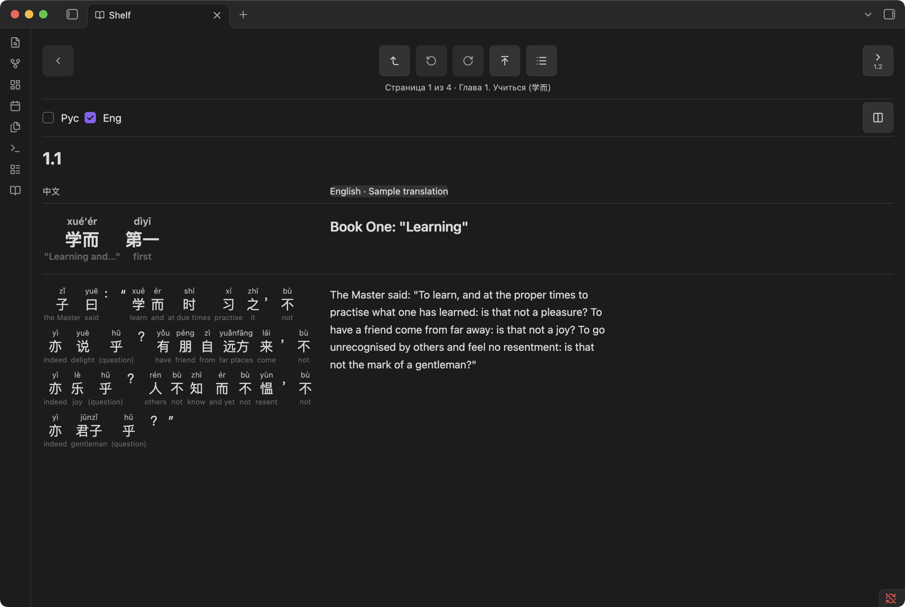
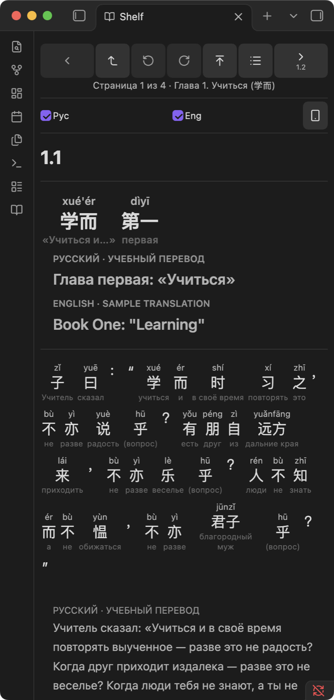
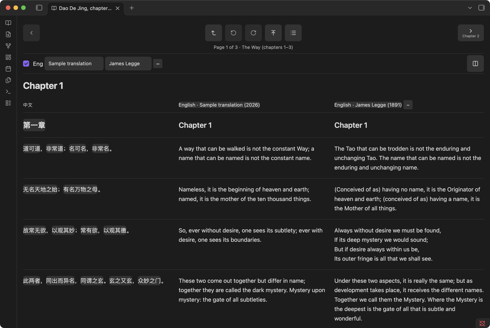
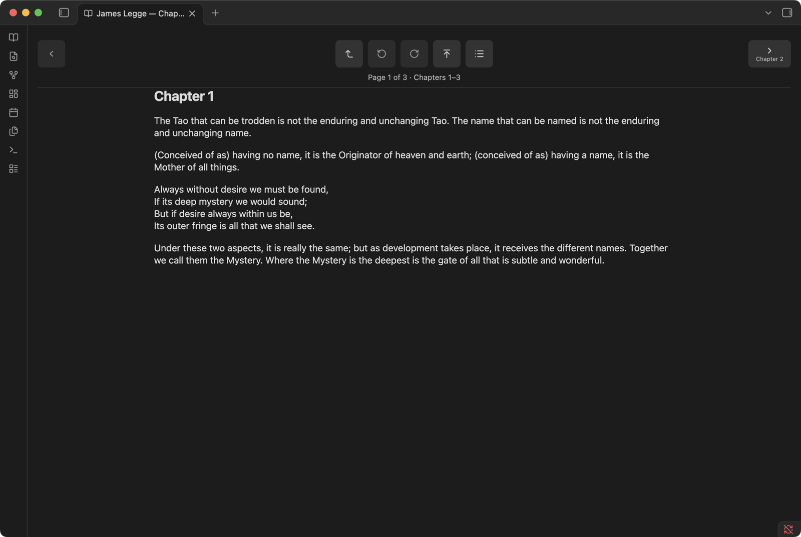
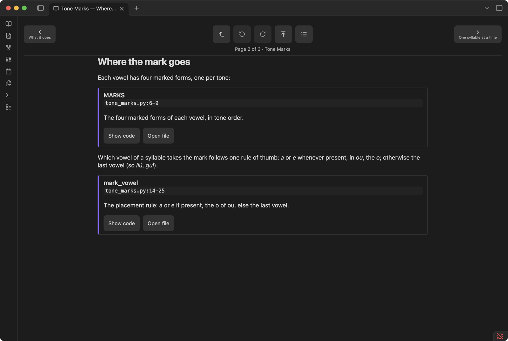
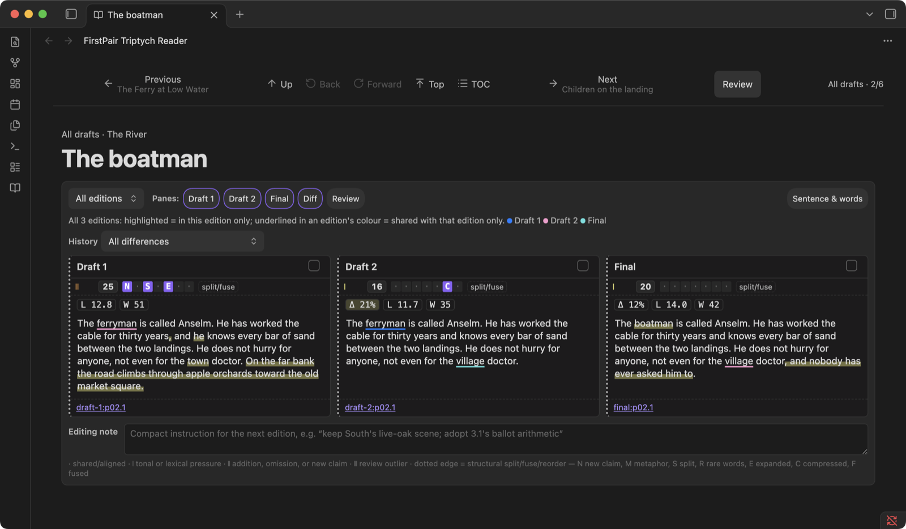

# Reading across languages in Obsidian: FirstPair Reader and Triptych

A book in two languages is two books that disagree on where the lines break. The original has its own paragraphs, its own idioms, its own words for which there is no single word on the other side. A translation smooths all of that over, which is what makes it readable and what makes it useless for learning. FirstPair Reader is our attempt to keep both books on the page at once: the source with its reading and a gloss under every word, one or more translations beside it, and the whole thing small enough to carry in an Obsidian vault on a phone.

Its companion, FirstPair Triptych, does the same for drafts of one text: three editions side by side, every change between them marked, so an editor can see what each revision did before deciding what the next one should do.

Both are Obsidian plugins, and both are now open source under the MIT license at [github.com/firstpair/firstpair-reader](https://github.com/firstpair/firstpair-reader). The repository comes with sample vaults built only from public-domain texts, and every screenshot below was taken in Obsidian from those samples.

## A shelf of books

One vault can hold several books, each in its own folder. The Reader finds them all and opens on a shelf: title, author, and the languages each book reads in.

Each book keeps its own place, its own history for Back, and its own choice of languages. Switching from a Chinese–English book to a Chinese–Russian one does not drag English columns along; coming back finds the first book exactly as it was left.

## The source, word by word

Open Lu Xun's *A Madman's Diary* (1918) and turn on 中文: the Chinese sits beside the English, paragraph by paragraph. One button cycles the Chinese through three layers: the text alone, the text with pinyin above each word, and the text with pinyin above and an English gloss below.

The glosses are the meaning of the word *in this sentence*: 精神 is "spirits" here, not "spirit" in the abstract; 了 is "(done)". A reader who knows some Chinese can read the left column alone and glance down only when a word stops them. A reader who knows none can still follow which words carry which part of the meaning.

## Two translations, glosses in either

A book may carry more than one translation. The *Analects* sample has a Russian and an English translation, and its interface is in Russian. With both shown, the word glosses follow the first column, so they are in Russian:

Turn Russian off and the glosses follow into English; a small picker can also fix the gloss language for the book.

The same book on a phone-sized window stacks the columns: Chinese with its layers first, then each translation under it. On a phone the translations become tabs, and the one chosen last opens first on every page.

## Two translations of the same language

Two English translations of one text are not redundant; they are an argument. The *Dao De Jing* sample sets a plain modern translation beside James Legge's of 1891, with the Chinese on the left. Here the Chinese is in its first layer, text only, with its words marked off; in a book that ships dictionaries, tapping one opens its entries in every shown language.

## Editions as a library

When the editions are whole books rather than columns, the Reader treats them as a library: each edition has its own contents and pages, grouped into families (here, English translations and the original), one tap apart.

## Books about code

The same reader handles a book whose subject is a program. Each chapter cites fragments of the code by file and line range; a card shows what the fragment does, **Show code** lists the numbered lines, and **Open file** opens the code note with those lines marked.

## Triptych: three drafts at once

FirstPair Triptych reads the drafts of one text as a sequence of pages, each page showing up to three editions side by side. The panes are not just placed next to each other: every word that appears in only one edition is highlighted, and text shared by two editions is underlined in the colour of the edition it is shared with. Small markers above each pane count the changes by kind (a new claim, a split sentence, an expansion), and the figures under them give the share of the text that changed, the average sentence length and the word count.

In this sample, the town becomes a village between the first and second drafts, the ferryman becomes a boatman in the last, a sentence about apple orchards is cut, and a final clause is added. Review shows where the edits are, part by part, and gathers the one-word substitutions that recur across the book into rules (every "ferryman" became "boatman"). An editing note under each page records what to do in the next pass; notes and spoken voice notes are kept in the vault, beside the text they refer to.

## How the books are made

The Reader does not convert anything. It reads a small index in the vault (`_data/reader.json`) and one JSON file per page, in which each unit carries its source text, its translations, and, for interlinear reading, its words as `[text, reading, gloss]`, with optional glosses in further languages. The vault also keeps the translation as plain Markdown notes, so it reads without the plugin. Any program that can write those files can make a book; the samples in the repository are generated by a short Python script that uses jieba to split the Chinese into words and pypinyin for the readings, with the glosses and translations written by hand.

The plugin makes no network requests. Everything it shows is in the vault, which is what lets the same book travel to an iPhone through Obsidian Sync or iCloud and read offline.

## Try it

Clone [firstpair/firstpair-reader](https://github.com/firstpair/firstpair-reader), copy one of the folders under `samples/` somewhere, install the plugin into it with `sh samples/build/install-plugins.sh <vault>`, and open the folder as a vault in Obsidian. The shelf, the single book, the library, the code book and the triptych are each one folder. `npm test` runs the plugins' tests with nothing but Node; the samples' own check loads every sample through the Reader's data contract.

The texts in the samples are in the public domain: Lu Xun's *A Madman's Diary* (1918), the opening of the *Analects*, the first chapters of the *Dao De Jing* with James Legge's translation (1891), and Lincoln's Gettysburg Address. The other translations, the glosses, the code book and the essay in the triptych sample were written for the samples and are released with the code.
